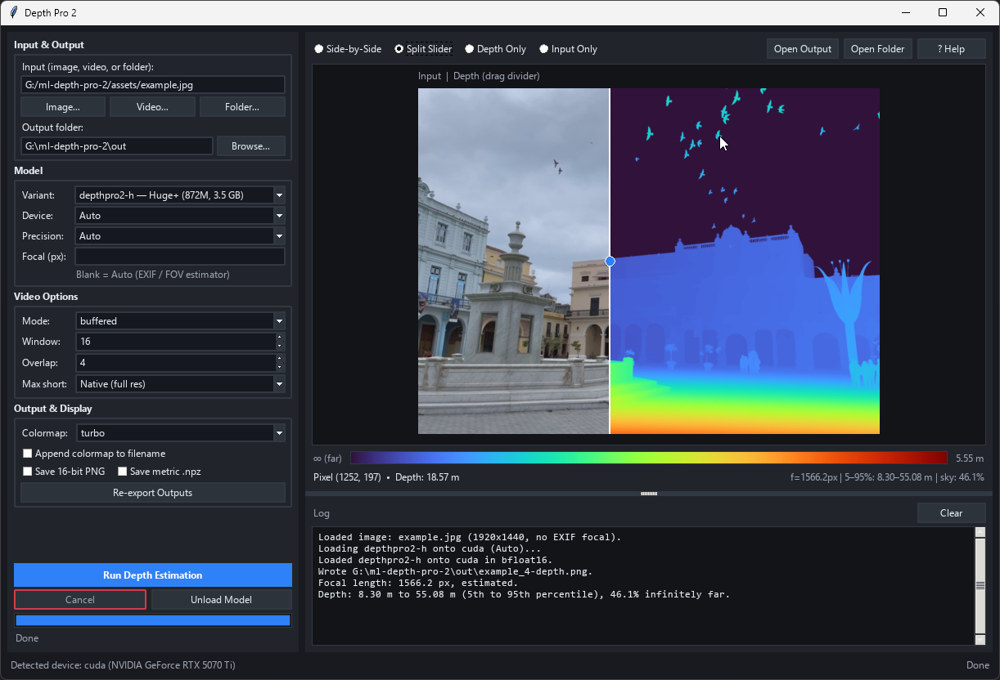

# Depth Pro 2 Desktop GUI

This fork adds a native desktop GUI built with Python's built-in `tkinter` / `ttk` (requiring no extra GUI dependencies) alongside Windows CUDA `uv` configuration.

## Features

- **Photos, Videos, and Folders**: Load a single image, preview frame 0 of a video, or batch-process an entire folder.
- **Interactive Preview**: Compare results in **Side-by-Side**, draggable **Split Slider**, **Depth Only**, or **Input Only** views.
- **Metric Hover Inspector**: Move your pointer over any preview image to read exact pixel coordinates `(x, y)` and depth in meters (`∞ (far / sky)` for infinite depth).
- **Live Colormap Switching & Re-export**: Switch between `turbo`, `inferno`, `magma`, `plasma`, `viridis`, and `gray` instantaneously without re-running inference, then click **Re-export Outputs** to save updated color PNGs/MP4s or 16-bit PNGs.
- **Live Progress & Console Logging**: Displays stage timers while loading/running clip 1 and real-time frame count, percentage, FPS, ETA, and CUDA VRAM usage in both the GUI and terminal console.
- **Model Caching & Memory Control**: Keeps the loaded model cached across runs for fast iteration, with **Unload Model** to free VRAM/RAM and **Cancel** to stop long video jobs cleanly.
- **Built-in Parameter Help**: Hover over any setting for a tooltip or click **? Help** in the toolbar to open the in-app Parameter Guide.

<p align="center">
  
</p>

## Quick Start

```bash
uv sync
uv run depth-pro-2 gui
# or:
uv run depth-pro-2-gui
```

> **Windows CUDA Note:** `pyproject.toml` configures `uv` to automatically pull PyTorch CUDA 13.2 (`cu132`) wheels on Windows (`sys_platform == 'win32'`), while leaving macOS and Linux resolution unchanged.

---

## Parameter Guide

### Input & Output

| Setting | What it does |
|---|---|
| **Input (image, video, or folder)** | Choose a photo, video file, or folder via **Image...**, **Video...**, or **Folder...**. Folders batch-process every supported image and video inside. |
| **Output folder** | Directory where results are written (`out/` by default): `<name>-depth.png` for photos and `<name>-depth.mp4` for videos. |

### Model

| Setting | Options / Default | What it does |
|---|---|---|
| **Variant** | `depthpro2-s`, `depthpro2-b`, `depthpro2-l`, `depthpro2-h` *(default)* | Controls accuracy vs. speed and VRAM. `S` (97 MB) is fastest and lightest; `B` (386 MB) and `L` (1.3 GB) balance speed and quality; `H+` (3.5 GB) gives the sharpest detail but requires the most VRAM. |
| **Device** | `Auto` *(default)*, `cuda`, `mps`, `cpu` | Hardware backend. `Auto` chooses CUDA (NVIDIA GPU), then MPS (Apple Silicon), then CPU. |
| **Precision** | `Auto` *(default)*, `bf16`, `fp16`, `fp32` | Numeric precision. `Auto` uses `bfloat16` on GPU (as trained) and `float32` on CPU. Use `fp16` on older GPUs without `bfloat16` support. |
| **Focal (px)** | Blank *(default)* or positive number | Horizontal camera focal length in pixels used for metric scale. Leave blank to read EXIF on photos or run the built-in FOV estimator. Scaling focal length by +10% scales all metric depths by +10%. |

### Video Options

| Setting | Options / Default | What it does |
|---|---|---|
| **Mode** | `buffered` *(default)*, `unbuffered` | `buffered` processes overlapping clips of `Window` frames so each frame sees future and past frames (smoothest). `unbuffered` predicts each frame as it arrives from past frames using a `Window`-frame KV cache (still scales VRAM with `Window`). |
| **Window** | `1–64` *(default `16`)* | Number of frames attended together. Higher values give steadier temporal depth, but VRAM scales directly with `Window × Width × Height`. |
| **Overlap** | `0–63` *(default `4`)* | Frames shared and cross-faded between consecutive clips in `buffered` mode to prevent flicker at clip boundaries. Must be strictly less than `Window`. Disabled in `unbuffered` mode. |
| **Max short** | `Native (full res)` *(default)*, `1080p`, `720p`, `540p`, `480p` | Downscales decoded video frames if their shorter side exceeds the chosen limit before inference. Lowering this dramatically reduces VRAM usage and speeds up video processing (any manual `Focal (px)` is scaled automatically). |

### Output & Display

| Setting | What it does |
|---|---|
| **Colormap** | Color palette (`turbo` default, `inferno`, `magma`, `plasma`, `viridis`, `gray`) used for previews and saved color depth maps. Updates the preview immediately without re-running the model. |
| **Append colormap to filename** | Appends `-<colormap>` to saved color PNG/MP4 filenames (for example `example-depth-inferno.png` or `example-depth-magma.mp4`) so you can export multiple colormaps without overwriting earlier files. |
| **Save 16-bit PNG (`--save-png16`)** | Also saves 16-bit grayscale inverse depth PNGs (`white = near`, `black = infinitely far`) for compositing tools like Nuke or Blender. The log prints the meter conversion formula. |
| **Save metric depth `.npz` (`--save-npz`)** | Also writes raw float32 `depth` (in meters) and `focallength_px` arrays. Note: videos write one `.npz` file per frame, which can consume large amounts of disk space. |
| **Re-export Outputs** | After depth estimation finishes, change **Colormap**, **Append colormap to filename**, **Save 16-bit PNG**, or **Output folder** and click **Re-export Outputs** to regenerate the saved PNG or MP4 without re-running the neural network. Videos are cached temporarily up to 2 GiB (exact per-frame video `.npz` export requires enabling **Save metric depth `.npz`** before running). |

> **Existing File Prompt:** Whenever an export or re-export target filename already exists in the output folder, the GUI asks whether to **Overwrite**, **Rename** (enter a custom base name or use auto-numbering, with **Auto-Rename** for batch folders), **Add Date & Time** (`_YYYYMMDD-HHMMSS`), or **Cancel**.

---

## Video VRAM & Performance Guide (16 GB GPUs)

Video memory scales with **Model size × Window × Frame resolution**. On Windows, exceeding physical GPU VRAM does **not** always raise an out-of-memory error—WDDM silently spills memory into shared system RAM, which can make clip 1 appear stuck at `0%` for several minutes.

Measured single-clip (`1920×1440`, `bf16`) benchmarks on an **NVIDIA RTX 5070 Ti (16 GB)**:

| Model | Mode | Window | Speed | Peak Allocated | Peak Reserved | Fits in 16 GB? |
|---|---|---:|---:|---:|---:|:---:|
| `depthpro2-s` | `buffered` | 16 | 4.03 fps | 4.05 GB | 5.64 GB | Yes |
| `depthpro2-b` | `buffered` | 16 | 2.32 fps | 7.66 GB | 9.30 GB | Yes |
| `depthpro2-h` | `buffered` | **4** | 1.00 fps | 9.34 GB | 13.91 GB | Yes |
| `depthpro2-h` | `buffered` | 8 | 0.15 fps | 12.75 GB | 16.67 GB | Spills to RAM |
| `depthpro2-h` | `buffered` | 16 | ~0.05 fps | 20.14 GB | 23.52 GB | Spills to RAM |
| `depthpro2-h` | `unbuffered` | 16 | 0.03 fps | 18.29 GB | 21.92 GB | Spills to RAM |

### Recommended Settings for 16 GB GPUs on HD+ Video
- **Highest detail at full resolution:** `depthpro2-h`, **Window** `4`, **Overlap** `1`
- **Fast + smooth temporal window:** `depthpro2-b` or `depthpro2-s` with default **Window** `16`, **Overlap** `4`
- **Larger window with `depthpro2-h`:** Set **Max short** to `720p` (or `540p`)
